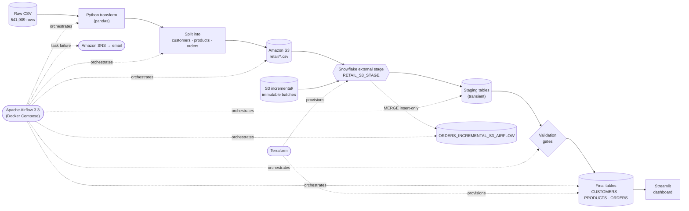
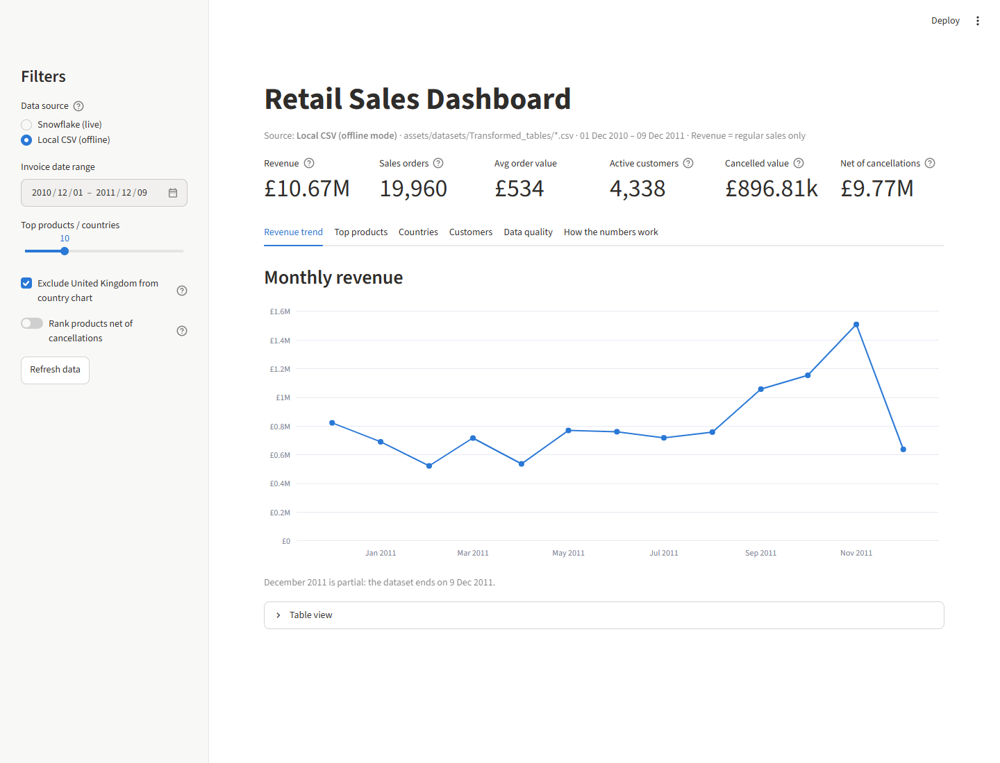
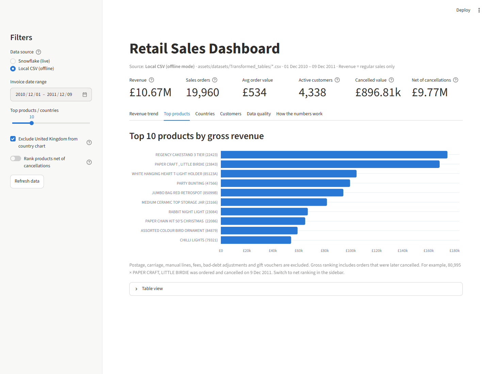
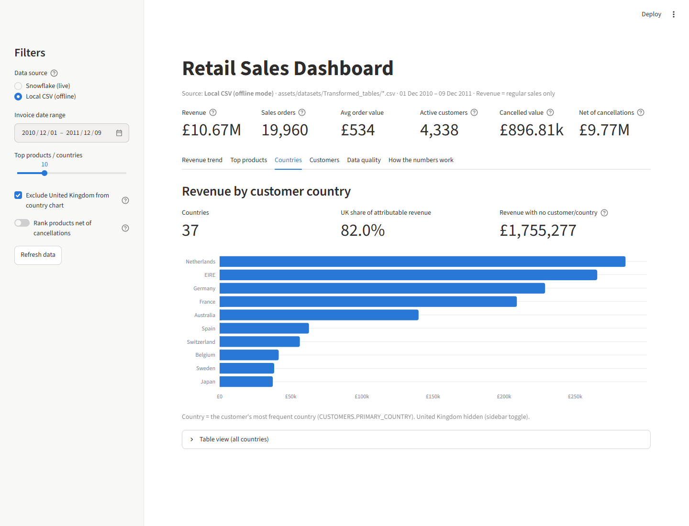
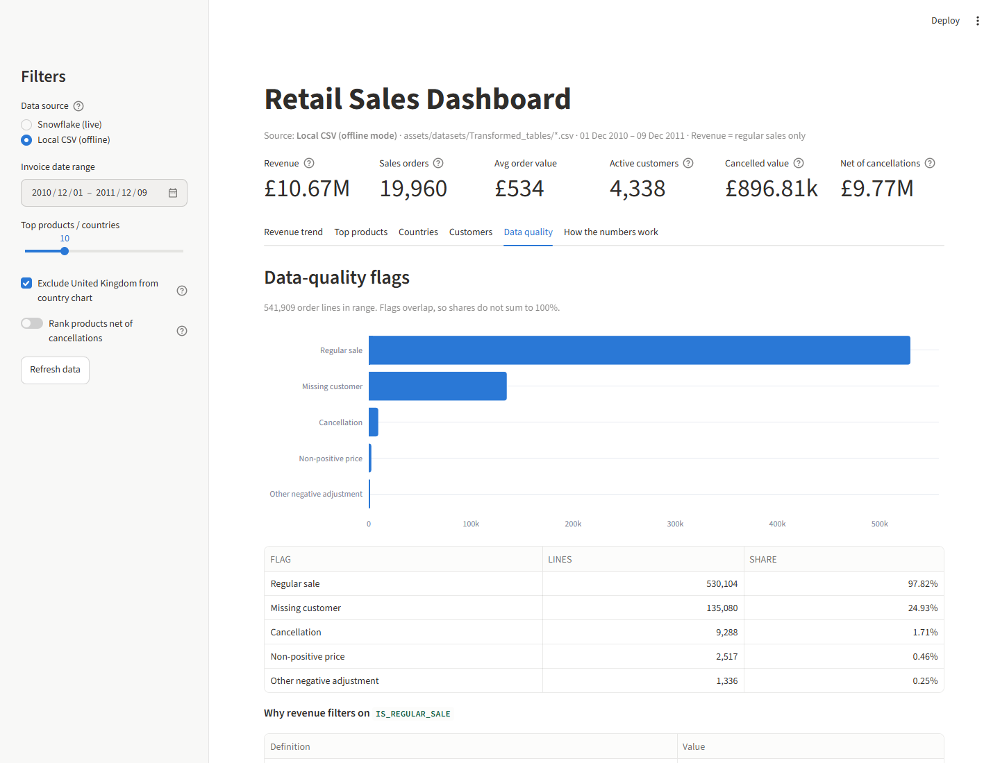

# Snowflake ETL Pipeline: Retail Transactions

An end-to-end, containerised ETL pipeline. It cleans 541,909 raw retail
transactions with **Python/pandas**, lands them in **Amazon S3**, and loads them
into **Snowflake** through an external stage, with validation gates at every
step. **Apache Airflow 3.3** orchestrates the pipeline in **Docker Compose**,
**Terraform** provisions the infrastructure, **Amazon SNS** sends failure
alerts, and a **Streamlit** dashboard sits on top.

> Built for the *Snowflake ETL Pipeline – Build Challenge*. All 8 core tasks
> and all 5 bonus challenges are implemented. See the
> [completion checklist](#challenge-completion-checklist).

---

## Contents

[Business problem](#business-problem) ·
[Architecture](#architecture) ·
[Tech stack](#technologies) ·
[Repository structure](#repository-structure) ·
[Prerequisites](#prerequisites) ·
[Setup](#setup) ·
[DAGs](#the-dags) ·
[Data quality](#data-quality-checks) ·
[Alerting](#monitoring-and-alerting) ·
[Lineage](#data-lineage) ·
[Dashboard](#dashboard) ·
[Testing](#testing-and-verification) ·
[Screenshots](#screenshots) ·
[Limitations](#known-limitations) ·
[Security](#security-considerations) ·
[Future work](#future-improvements)

---

## Business problem

A UK online gift retailer exports a year of transactions (Dec 2010 – Dec 2011)
as one CSV. The file mixes real sales with cancellations, stock write-offs,
zero-price lines and guest checkouts. A naive `SUM(quantity * price)` over it
understates sales by about **£919k (8.6%)**.

The pipeline turns that file into **trusted, query-ready tables**:

* Each line is classified with explicit data-quality flags, so revenue,
  cancellations and adjustments can be reported separately rather than
  silently netted.
* Customers, products and orders are split into an analytical model.
* Snowflake loads are reproducible and validated, so nothing reaches the
  final tables unless counts, keys and staging↔final consistency checks
  pass.
* Engineers are told by email when anything fails.

## Architecture



**Runtime layout:** PostgreSQL (Airflow metadata), Redis (Celery broker), and
the Airflow API server, scheduler, DAG processor, Celery worker and
triggerer, all from [`docker-compose.yaml`](docker-compose.yaml).
Snowflake: region **eu-west-2**, database `RETAIL_ETL_DB`, schema
`RETAIL`, warehouse `RETAIL_ETL_WH` (XSMALL, auto-suspend 60 s).

## Technologies

| Area | Tools |
|---|---|
| Processing | Python 3, pandas, boto3 (managed multipart uploads) |
| Orchestration | Apache Airflow 3.3.0 (CeleryExecutor), `BashOperator`, `SQLExecuteQueryOperator`, `SQLCheckOperator`, TaskFlow `@task` |
| Containers | Docker Compose, PostgreSQL 16, Redis 7 |
| Cloud storage | Amazon S3 (eu-west-2) |
| Warehouse | Snowflake (storage integration, external stage, transient staging tables, `COPY INTO`, `MERGE`, `INSERT OVERWRITE`) |
| IaC | Terraform ≥ 1.5 with `snowflakedb/snowflake` provider ~> 2.20 |
| Monitoring | Amazon SNS email alerts via the Airflow Amazon provider |
| Analytics | Streamlit, Plotly, `snowflake-connector-python` |
| Quality | pytest (DAG integrity, transformations, SNS, lineage, dashboard) |

## Repository structure

```text
.
├── airflow/
│   ├── dags/
│   │   ├── retail_etl_dag.py              # full refresh, 11 tasks
│   │   ├── incremental_s3_orders_dag.py   # insert-only incremental, 8 tasks
│   │   ├── incremental_orders_test_dag.py # isolated MERGE/idempotency test
│   │   └── connection_healthcheck_dag.py  # read-only AWS + Snowflake checks
│   ├── plugins/etl_sns_alerts.py          # SNS on_failure_callback
│   └── logs/                              # (git-ignored)
├── assets/datasets/                       # data files are git-ignored
│   ├── Original_file/                     # data.csv (raw input)
│   ├── Transformed_full/                  # transformed_data.csv
│   ├── Transformed_tables/                # customers / products / orders.csv
│   └── Incremental_batches/               # orders_batch_###.csv
├── dashboard/                             # Streamlit app, SQL, README
├── docker/Dockerfile                      # Airflow image + boto3[crt]
├── docs/                                  # lineage, alerting, connections, screenshots
├── lineage/lineage.json                   # machine-readable lineage
├── python_scripts/                        # transform, split, upload, batches, alert test
├── terraform/                             # warehouse, DB, schema, tables, integration, stage
├── tests/                                 # pytest suite
├── docker-compose.yaml
├── Makefile
├── .env.example                           # placeholders only
└── requirements-dev.txt
```

## Prerequisites

* Docker Desktop (about 4 GB RAM free for Airflow)
* Terraform ≥ 1.5, AWS CLI v2, Git, Python 3.12+ (tests and dashboard)
* An AWS account with an S3 bucket in eu-west-2 and permission to use `aws login`
* A Snowflake account (the free trial works) with a role that can create
  warehouses, databases and integrations (Terraform) and read/write the
  `RETAIL` schema (Airflow)
* The [UCI Online Retail dataset](https://archive.ics.uci.edu/dataset/352/online+retail)
  saved as CSV at `assets/datasets/Original_file/data.csv`

## Setup

### 1. Environment

```powershell
git clone https://github.com/Fer-as/snowflake-etl-pipeline.git
cd snowflake-etl-pipeline
copy .env.example .env      # then fill in every <placeholder>
```

`.env` holds Airflow secrets, local Postgres credentials and the SNS topic
ARN. It is git-ignored. **No AWS keys go in it.**

### 2. AWS

1. **Bucket:** create `<bucket>` in eu-west-2. Data lands under `retail/`
   (full refresh) and `retail/incremental/` (batches).
2. **Your identity** (used by Airflow through `aws login`) needs
   `s3:PutObject`, `s3:GetObject` and `s3:ListBucket` on the bucket/prefix,
   plus `sns:Publish` and `sns:GetTopicAttributes` on the alert topic.
3. **Snowflake's IAM role** (`retail_s3_role_arn`) needs read-only access:
   `s3:GetObject` and `s3:GetObjectVersion` on `retail/*`, and `s3:ListBucket`
   conditioned on the `retail/` prefix. After `terraform apply`, run
   `DESC INTEGRATION RETAIL_S3_INTEGRATION` and put `STORAGE_AWS_IAM_USER_ARN`
   and `STORAGE_AWS_EXTERNAL_ID` into the role's trust policy.
4. **SNS:** see [docs/monitoring_and_alerting.md](docs/monitoring_and_alerting.md#setup-one-time).
5. Run `aws login`. The containers mount `~/.aws/config` (read-only) and the
   login cache, so they always use **temporary** credentials.

### 3. Snowflake infrastructure (Terraform)

Terraform provisions the warehouse, database, schema, the three final tables,
the S3 storage integration and the external stage.

```powershell
cd terraform
# Provider auth: programmatic access token (no password in files)
$env:SNOWFLAKE_ORGANIZATION_NAME = "<org>"
$env:SNOWFLAKE_ACCOUNT_NAME      = "<account>"
$env:SNOWFLAKE_USER              = "<user>"
$env:SNOWFLAKE_TOKEN             = "<programmatic-access-token>"
$env:TF_VAR_retail_s3_role_arn   = "arn:aws:iam::<aws-account-id>:role/<snowflake-s3-role>"

terraform init
terraform fmt -check ; terraform validate
terraform plan        # review: an existing deployment should show no changes
terraform apply       # only for a new environment
```

State (`*.tfstate`) is local and git-ignored. Staging and incremental tables
are created by the DAGs, not by Terraform (see [limitations](#known-limitations)).

### 4. Start Airflow

```powershell
docker compose up -d --build        # or: make up
docker compose ps                   # all services healthy / running
```

Open <http://localhost:8080>. Airflow 3 uses the *simple auth manager* with the
user `admin`. The generated password is printed in the API server log
(`docker compose logs airflow-api-server | Select-String password`).

### 5. Airflow connections

| Conn ID | How it is defined |
|---|---|
| `snowflake_default` | UI *Admin → Connections* (stored encrypted in the metadata DB) |
| `aws_default` | Environment variable in `docker-compose.yaml`, **with no keys**: it falls back to the temporary `aws login` session |

Field-by-field instructions, the design decision and troubleshooting are in
[docs/airflow_connections.md](docs/airflow_connections.md). Verify both
connections with the read-only `connection_healthcheck` DAG (`make healthcheck`).

## The DAGs

All DAGs are manual (`schedule=None`), allow one active run, and retry each
task once after 2 minutes. Production tasks send an SNS alert after the
final failure.

### `retail_etl_pipeline`: full refresh (11 tasks)

```text
transform_data → split_into_tables → upload_to_s3 → verify_snowflake
→ stage_customers → stage_products → stage_orders → validate_staging
→ publish_to_snowflake → validate_published_data → validate_final_consistency
```

1. **Transform** ([`transform_data_script.py`](python_scripts/transform_data_script.py)):
   reads the cp1252 CSV, renames columns to snake_case, casts `CustomerID` to
   nullable integer, parses dates, and adds 5 quality flags. **No rows are
   dropped.**
2. **Split** ([`split_data_into_tables.py`](python_scripts/split_data_into_tables.py)):
   produces customers (most frequent country), products (most frequent
   description) and orders (all lines + generated `order_line_id`).
3. **Upload** ([`upload_data_to_s3_bucket.py`](python_scripts/upload_data_to_s3_bucket.py)):
   writes `s3://<bucket>/retail/*.csv` using multipart transfer.
4. **Load:** `CREATE OR REPLACE TRANSIENT TABLE … LIKE <final>`, then
   `COPY INTO … FROM @RETAIL_S3_STAGE FILES=(…) ON_ERROR='ABORT_STATEMENT'`.
5. **Gate:** `validate_staging` must pass before anything is published.
6. **Publish:** `INSERT OVERWRITE` into all three final tables **inside one
   transaction**, so readers never see a half-refreshed model.
7. **Verify:** counts, keys and a two-way `EXCEPT` between final and staging.

### `incremental_s3_orders`: insert-only incremental (8 tasks)

```text
upload_batch_001 → upload_batch_002 → create_incremental_target → validate_s3_batches
→ merge_incremental_orders → validate_incremental_target
→ replay_incremental_batches → validate_idempotency
```

* Batches are **immutable**. The uploader writes with S3 `If-None-Match: *`, and
  if the object already exists it accepts it only when the bytes are
  identical.
* Snowflake reads every `incremental/orders_batch_###.csv` and tags each row
  with `METADATA$FILENAME` and `METADATA$FILE_ROW_NUMBER`. That pair is the
  record identity.
* `MERGE … WHEN NOT MATCHED THEN INSERT` adds only unseen identities to
  `ORDERS_INCREMENTAL_S3_AIRFLOW`, a separate table, so `ORDERS` is never
  touched.
* The DAG then **replays the MERGE** and proves nothing changed. Repeated runs
  keep exactly **8 rows**: 4 from batch 001, including a deliberate duplicate
  line, and 4 from batch 002.

### Supporting DAGs

* `connection_healthcheck` (read-only): STS identity, bucket + 3 CSVs, SNS
  topic, and Snowflake tables.
* `incremental_orders_test`: an earlier, isolated MERGE/idempotency test on
  scratch tables.

## Data quality checks

| Layer | Check |
|---|---|
| Transform | Required columns present; types cast; 5 flags computed for every row |
| Split | Uniqueness of `customer_id`, `stock_code`, `order_line_id` printed to the task log |
| Load | `COPY … ON_ERROR = 'ABORT_STATEMENT'`: any bad record fails the load |
| `validate_staging` | Exactly 4,372 / 4,070 / 541,909 rows; keys unique and non-null |
| `validate_published_data` | Same rules on the final tables |
| `validate_final_consistency` | Final ≡ staging (`EXCEPT` in both directions, all three tables) |
| Incremental | Batch row counts, unique source identities, required fields, source ↔ target reconciliation, replay idempotency |
| Tests | Full-dataset flag profile, revenue reconciliation, DAG structure |

Flag profile: 530,104 regular sales · 9,288 cancellations · 1,336 other
negative adjustments · 2,517 non-positive prices · 135,080 missing customers.

## Monitoring and alerting

Each task in both ETL DAGs has `on_failure_callback=send_sns_failure_alert`.
Airflow calls it only once the task has **failed for good**. An attempt that
will be retried does not alert, so one broken task produces one email.

The email carries the DAG, task, run, attempt, error class and a log link. It
never contains exception text, which could leak SQL or connection details.
The callback publishes through `SnsHook(aws_conn_id="aws_default")` and never
raises, so a broken alert can't mask the real failure.

```powershell
make alert-test     # one real email through the production callback, no data touched
```

Setup, IAM policy, behaviour matrix and troubleshooting:
[docs/monitoring_and_alerting.md](docs/monitoring_and_alerting.md).

## Data lineage

[docs/lineage.md](docs/lineage.md) contains:

* Mermaid lineage diagrams covering the raw file, scripts, CSVs, S3 objects,
  stage, staging tables, final tables, incremental batches and Airflow
  validation gates.
* Column-level lineage, generated identifiers and quality-flag semantics.
* Full refresh vs insert-only comparison, and the limits of file-position
  identifiers.

[`lineage/lineage.json`](lineage/lineage.json) is the machine-readable
version. `tests/test_lineage.py` fails if it drifts from the DAG task IDs,
the code paths or the Terraform schemas.

## Dashboard

```powershell
pip install -r dashboard/requirements.txt
streamlit run dashboard/app.py                        # Snowflake (set SNOWFLAKE_* first)
$env:DASHBOARD_DATA_SOURCE="local"; streamlit run dashboard/app.py   # offline, no credentials
```

The dashboard shows revenue, orders, AOV, customers, cancellations, the
monthly trend, top products (gross or net of cancellations), revenue by
country, customer statistics and data quality.

Revenue counts **regular sales only**. Cancellations are reported
separately. Rows with no customer are kept in revenue but excluded from
customer and country views. Details and auth options are in
[dashboard/README.md](dashboard/README.md).

## Testing and verification

```powershell
pip install -r requirements-dev.txt
python -m pytest            # 56 local tests (DAG tests skip without Airflow)
make test-dags              # full suite inside the Airflow 3.3.0 image
make tf-check               # terraform fmt -check + validate
docker compose config -q    # compose syntax
```

| What | How | Status |
|---|---|---|
| Transform/split/upload logic | Unit tests + full-dataset profile | ✅ automated |
| Refactored scripts produce identical output | SHA-256 of all 4 CSVs vs the original scripts, in the Airflow image | ✅ byte-identical |
| DAGs import; 11/8-task order unchanged; callbacks + retries on every task | `tests/test_dag_integrity.py` in the Airflow image | ✅ automated |
| SNS callback logic (ARN validation, no secret leakage, never raises) | `tests/test_sns_alerts.py` | ✅ automated |
| Lineage manifest matches code and schema | `tests/test_lineage.py` | ✅ automated |
| Dashboard SQL safety, credentials handling, reconciliation, headless render | `tests/test_dashboard.py` | ✅ automated |
| Terraform | `fmt -check`, `validate` | ✅ (no plan/apply) |
| Full-refresh and incremental DAG runs against AWS + Snowflake | Airflow UI | ✅ verified in earlier runs; re-run after this change (see below) |
| SNS email from a failing task | Temporary failing DAG (since removed) | ✅ verified earlier; `make alert-test` re-checks the new callback |

**Manual cloud verification after pulling these changes:** `aws login`, then
`docker compose up -d`. Next, `make healthcheck`, `make alert-test`, and
trigger `incremental_s3_orders`, which is idempotent and leaves the target
unchanged. Optionally re-run `retail_etl_pipeline` (a full refresh rewrites
the final tables with identical data). Finally, run the dashboard in
Snowflake mode and confirm revenue **£10,666,684.54** (hover the KPI).

## Screenshots

| Revenue trend | Top products |
|---|---|
|  |  |
| **Countries** | **Data quality** |
|  |  |

These were captured in offline mode; the caption under each title names the
source. Airflow, SNS and Snowsight screenshots need live services, and a
capture checklist is in [docs/screenshots/README.md](docs/screenshots/README.md).

## Known limitations

* **Hard-coded expected counts** (4,372 / 4,070 / 541,909) suit this static
  dataset. A changing source would need relative or threshold checks.
* **`ORDER_LINE_ID` is positional**, so it is stable only for an unchanged
  source file. That is acceptable for full refresh but not as an incremental
  key.
* **Incremental loading is insert-only and file-position based.** It does not
  propagate updates or deletes, it loads business duplicates in different
  files twice, it rescans every batch on each run, and it uses demo-specific
  row-count checks. See [lineage §8](docs/lineage.md#8-limitations-of-source-file-based-incremental-identifiers).
* **Country is per customer**, not per order (the mode country). About 25% of
  revenue has no customer and therefore no country.
* **Local-development credentials:** containers mount the host's AWS login
  cache, which is fine for a laptop and wrong for a server. Use an instance or
  task role there.
* **Terraform covers Snowflake only.** The S3 bucket, IAM roles and SNS topic
  were created manually. Transient staging/incremental tables are created by
  the DAGs.
* **Bucket name default** is in code (overridable with `RETAIL_S3_BUCKET`), and
  it contains the AWS account ID.
* **Single retry with a fixed 2-minute delay** and no SLA/deadline alerts.

## Security considerations

* **No static cloud keys anywhere.** AWS uses temporary `aws login`
  credentials, mounted read-only for config. Snowflake uses a programmatic
  access token for Terraform and an encrypted Airflow connection.
* `.env`, `dashboard/.env`, `*.tfstate`, `*.tfvars`, logs and data files are
  git-ignored. `.env.example` holds placeholders only. The git history was
  scanned for key patterns and none were found.
* Airflow secrets (Fernet key, JWT secret) come from `.env`. Connection
  passwords and extras are Fernet-encrypted in the metadata DB.
* Least privilege: the Snowflake storage integration is read-only on
  `retail/`. A read-only dashboard role is documented, and the dashboard's SQL
  is tested to contain no DDL or DML.
* Alert emails exclude exception messages. The callback validates the topic
  ARN.
* The dashboard uses bind parameters only, with no string-built SQL.
* Terraform state contains sensitive values. Keep it local or in an
  encrypted remote backend, never in Git.

## Future improvements

* Remote Terraform state (S3 + DynamoDB lock), and manage the bucket, IAM
  roles and SNS topic with the AWS provider.
* Replace hard-coded counts with checks relative to the source, for example
  rows read vs rows loaded from `COPY` results, or use Great Expectations /
  Soda.
* Incremental: `COPY INTO` load history or Snowpipe, business-key
  deduplication, `MERGE … WHEN MATCHED THEN UPDATE` for corrections, and
  streams/tasks.
* Snowflake key-pair auth for Airflow, and an AWS `role_arn` connection for
  servers.
* OpenLineage: the provider is already in the Airflow image, and could emit
  lineage events to Marquez automatically.
* CI (GitHub Actions) running pytest, `terraform validate` and DAG integrity
  on every push.
* SLA/deadline alerts and Slack notifications; a dashboard on incremental
  freshness.

## Challenge completion checklist

| # | Task | Status | Evidence |
|---|---|---|---|
| 1 | Environment configuration | ✅ | `.env.example`, git-ignored `.env`, temporary AWS creds, PAT for Snowflake |
| 2 | Docker environment | ✅ | `docker-compose.yaml` (Postgres, Redis, API server, scheduler, DAG processor, worker, triggerer) |
| 3 | Python processing scripts | ✅ | `python_scripts/` + unit tests |
| 4 | Terraform infrastructure | ✅ | Warehouse, DB, schema, tables, storage integration, stage; `fmt`/`validate` pass |
| 5 | Airflow DAG | ✅ | `retail_etl_pipeline` (transform → split → S3 → Snowflake, retries, validation) |
| 6 | Airflow connections | ✅ | `snowflake_default` + key-less `aws_default`; health-check DAG |
| 7 | SQL loading scripts | ✅ | `COPY INTO` from the external stage, `INSERT OVERWRITE`, `MERGE` (in the DAGs) |
| 8 | Testing & validation | ✅ | SQL validation gates + pytest suite |
| B1 | Data validation checks | ✅ | 6 `SQLCheckOperator` gates |
| B2 | Incremental loading | ✅ | `incremental_s3_orders` (insert-only, idempotent) |
| B3 | Monitoring & alerting | ✅ | SNS `on_failure_callback` on every task |
| B4 | Data lineage | ✅ | `docs/lineage.md`, `lineage/lineage.json` + tests |
| B5 | Dashboard | ✅ | `dashboard/` (Streamlit) |
