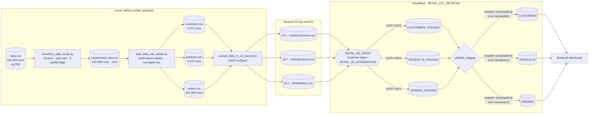
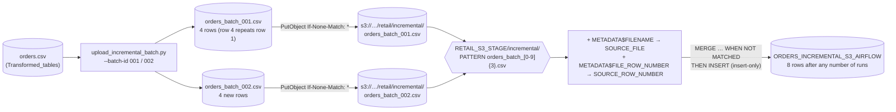

# Data Lineage

This document traces every dataset in the pipeline from the original CSV to
the Snowflake tables used by the dashboard. The machine-readable version
is [`lineage/lineage.json`](../lineage/lineage.json), which is checked by
`tests/test_lineage.py` so the documentation cannot silently drift away
from the code.

**Contents**

1. [End-to-end lineage (full refresh)](#1-end-to-end-lineage-full-refresh)
2. [Incremental batch lineage](#2-incremental-batch-lineage)
3. [Airflow orchestration and validation](#3-airflow-orchestration-and-validation)
4. [Column-level lineage](#4-column-level-lineage)
5. [Generated identifiers](#5-generated-identifiers)
6. [Data-quality flags](#6-data-quality-flags)
7. [Full refresh vs insert-only incremental](#7-full-refresh-vs-insert-only-incremental)
8. [Limitations of source-file identifiers](#8-limitations-of-source-file-based-incremental-identifiers)
9. [How to trace a single record](#9-how-to-trace-a-single-record)

---

## 1. End-to-end lineage (full refresh)



| Step | Code | Input | Output |
|---|---|---|---|
| Transform | [`python_scripts/transform_data_script.py`](../python_scripts/transform_data_script.py) | `assets/datasets/Original_file/data.csv` | `assets/datasets/Transformed_full/transformed_data.csv` |
| Split | [`python_scripts/split_data_into_tables.py`](../python_scripts/split_data_into_tables.py) | `transformed_data.csv` | `assets/datasets/Transformed_tables/{customers,products,orders}.csv` |
| Upload | [`python_scripts/upload_data_to_s3_bucket.py`](../python_scripts/upload_data_to_s3_bucket.py) | the three CSVs | `s3://<bucket>/retail/{customers,products,orders}.csv` |
| Stage | `stage_*` tasks in [`retail_etl_dag.py`](../airflow/dags/retail_etl_dag.py) | `@RETAIL_S3_STAGE/<file>.csv` | `*_STAGING` transient tables |
| Publish | `publish_to_snowflake` | `*_STAGING` | `CUSTOMERS`, `PRODUCTS`, `ORDERS` |

The external stage `RETAIL_S3_STAGE` points at `s3://<bucket>/retail/` and
authenticates with the storage integration `RETAIL_S3_INTEGRATION` (an IAM
role that Snowflake assumes). Both are created by Terraform
([`terraform/stage.tf`](../terraform/stage.tf),
[`terraform/storage_integration.tf`](../terraform/storage_integration.tf)).

---

## 2. Incremental batch lineage



* Batches are **immutable**: the uploader writes with `If-None-Match: *`, so
  S3 rejects an overwrite. If the object already exists, its bytes are
  compared with the expected content, and a mismatch fails the task.
* Snowflake reads the files **directly from the stage**. No staging table
  is used. `METADATA$FILENAME` and `METADATA$FILE_ROW_NUMBER` become part of
  every row, which gives row-level lineage back to the exact S3 object and
  line.
* The incremental target is a **separate table**. It never modifies
  `ORDERS`.

---

## 3. Airflow orchestration and validation

```mermaid
flowchart TB
    subgraph FR["DAG retail_etl_pipeline (11 tasks, full refresh)"]
        direction LR
        a1[transform_data] --> a2[split_into_tables] --> a3[upload_to_s3] --> a4[verify_snowflake]
        a4 --> a5[stage_customers] --> a6[stage_products] --> a7[stage_orders]
        a7 --> a8{{validate_staging}} --> a9[publish_to_snowflake]
        a9 --> a10{{validate_published_data}} --> a11{{validate_final_consistency}}
    end

    subgraph INC["DAG incremental_s3_orders (8 tasks, insert-only)"]
        direction LR
        b1[upload_batch_001] --> b2[upload_batch_002] --> b3[create_incremental_target]
        b3 --> b4{{validate_s3_batches}} --> b5[merge_incremental_orders]
        b5 --> b6{{validate_incremental_target}} --> b7[replay_incremental_batches]
        b7 --> b8{{validate_idempotency}}
    end

    SNS(["Amazon SNS topic<br/>retail-etl-airflow-alerts → email"])
    FR -. "on_failure_callback<br/>(after final retry)" .-> SNS
    INC -. "on_failure_callback<br/>(after final retry)" .-> SNS
```



Hexagons are `SQLCheckOperator` gates. If any boolean column in the check
query is `FALSE`, the task fails, the downstream tasks do not run, and an
SNS email is sent.

| Gate | What it proves |
|---|---|
| `validate_staging` | Staging row counts are 4,372 / 4,070 / 541,909, and keys are unique and non-null, **before** anything is published |
| `validate_published_data` | The same rules hold on the final tables after `INSERT OVERWRITE` |
| `validate_final_consistency` | Final = staging in both directions (`EXCEPT` both ways), so nothing was lost or added |
| `validate_s3_batches` | Batch 001 and 002 each have 4 rows, identities are unique, and required fields are present |
| `validate_incremental_target` | Every staged identity is in the target, with no extras and no duplicates |
| `validate_idempotency` | A replayed MERGE inserted nothing, so the target still matches the source exactly |

---

## 4. Column-level lineage

### ORDERS (`RETAIL_ETL_DB.RETAIL.ORDERS`)

| Raw column (`data.csv`) | Transformation | Snowflake column | Type |
|---|---|---|---|
| — | Generated: row position 1..N in `split_data_into_tables.py` | `ORDER_LINE_ID` | `NUMBER(38,0)` NOT NULL |
| `InvoiceNo` | Renamed; read as string (keeps the `C` prefix) | `INVOICE_NUMBER` | `VARCHAR` |
| `StockCode` | Renamed; read as string (keeps codes such as `85123A`) | `STOCK_CODE` | `VARCHAR` |
| `CustomerID` | Float to nullable `Int64` (`17850.0` becomes `17850`); NaN becomes empty, then NULL | `CUSTOMER_ID` | `NUMBER(38,0)` |
| `InvoiceDate` | Parsed from `m/d/YYYY H:MM` to ISO timestamp | `INVOICE_DATE` | `TIMESTAMP_NTZ` |
| `Quantity` | Renamed; negative values kept | `QUANTITY` | `NUMBER(38,0)` |
| `UnitPrice` | Renamed; zero/negative values kept | `UNIT_PRICE` | `NUMBER(18,4)` |
| `InvoiceNo` | `startswith("C")` | `IS_CANCELLATION` | `BOOLEAN` |
| `Quantity`, `InvoiceNo` | `quantity < 0 AND NOT is_cancellation` | `IS_OTHER_NEGATIVE_ADJUSTMENT` | `BOOLEAN` |
| `UnitPrice` | `unit_price <= 0` | `IS_NONPOSITIVE_PRICE` | `BOOLEAN` |
| `Quantity`, `UnitPrice`, `InvoiceNo` | `quantity > 0 AND unit_price > 0 AND NOT is_cancellation` | `IS_REGULAR_SALE` | `BOOLEAN` |
| `CustomerID` | `customer_id IS NULL` | `IS_MISSING_CUSTOMER` | `BOOLEAN` |
| `Description` | **Not stored in ORDERS** (moved to PRODUCTS) | — | — |
| `Country` | **Not stored in ORDERS** (moved to CUSTOMERS) | — | — |

### CUSTOMERS (`RETAIL_ETL_DB.RETAIL.CUSTOMERS`)

| Source | Transformation | Column |
|---|---|---|
| `CustomerID` | Distinct non-null IDs | `CUSTOMER_ID` (NOT NULL, unique) |
| `Country` | **Mode** (most frequent) country per customer; ties go to the alphabetically first | `PRIMARY_COUNTRY` |

### PRODUCTS (`RETAIL_ETL_DB.RETAIL.PRODUCTS`)

| Source | Transformation | Column |
|---|---|---|
| `StockCode` | Distinct codes | `STOCK_CODE` (NOT NULL, unique) |
| `Description` | **Mode** description per code; null for 112 codes with no description | `DESCRIPTION` |

### ORDERS_INCREMENTAL_S3_AIRFLOW

Same business columns as ORDERS (without `ORDER_LINE_ID`), plus:

| Source | Column |
|---|---|
| `METADATA$FILENAME` (file path reported by the stage, ending in `incremental/orders_batch_001.csv`) | `SOURCE_FILE` |
| `METADATA$FILE_ROW_NUMBER` (1-based line number in the file) | `SOURCE_ROW_NUMBER` |

> **Analytics consequence:** `Country` reaches Snowflake only as
> `CUSTOMERS.PRIMARY_COUNTRY`. Revenue by country must therefore join
> `ORDERS` to `CUSTOMERS`. This excludes the 135,080 rows (24.9%) with no
> customer ID, and it assigns a customer's whole revenue to their most
> frequent country. The dashboard labels this explicitly.

---

## 5. Generated identifiers

| Identifier | Where | Stable? | Notes |
|---|---|---|---|
| `ORDER_LINE_ID` | `split_data_into_tables.py` | **Only for an unchanged source file** | Position-based 1..N. If the source file is re-ordered or gains rows, IDs shift. That is acceptable for a full refresh, because every table is rebuilt together, but it is unsuitable as an incremental key. That is why the incremental DAG does not use it. |
| `SOURCE_FILE` + `SOURCE_ROW_NUMBER` | Snowflake metadata at read time | Stable while files are immutable | Composite key of the incremental target, enforced by MERGE and validated for uniqueness. |
| `CUSTOMER_ID`, `STOCK_CODE` | Source system | Yes | Natural keys of the dimension tables. |

---

## 6. Data-quality flags

Profile of the full dataset (asserted by `tests/test_transformations.py::test_full_dataset_profile`):

| Flag | Rows | Share | Meaning / treatment in analytics |
|---|---:|---:|---|
| `IS_REGULAR_SALE` | 530,104 | 97.8% | **The only rows used for revenue.** |
| `IS_CANCELLATION` | 9,288 | 1.7% | Credit notes (`C…` invoices, negative quantity). Counted separately as cancelled value, never subtracted from or added to sales. |
| `IS_OTHER_NEGATIVE_ADJUSTMENT` | 1,336 | 0.2% | Stock write-offs and corrections with negative quantity and no `C` prefix. All have price 0, so they carry no monetary value. Excluded from revenue. |
| `IS_NONPOSITIVE_PRICE` | 2,517 | 0.5% | Price ≤ 0 (free items, "Adjust bad debt"). Excluded from revenue. |
| `IS_MISSING_CUSTOMER` | 135,080 | 24.9% | Guest/unknown customer. **Included in revenue**, but excluded from per-customer and per-country metrics. |

Flags overlap. For example, every negative adjustment has price 0, so it
also sets `IS_NONPOSITIVE_PRICE`. In total, 11,805 rows are not regular
sales. `IS_REGULAR_SALE` is defined so that it can never overlap with
cancellations, negative quantities or non-positive prices. Summing
`QUANTITY * UNIT_PRICE` over regular sales therefore cannot double count or
net off returns.

| Revenue definition (full dataset) | Value |
|---|---:|
| `SUM(QUANTITY * UNIT_PRICE)` over **regular sales** (used by the dashboard) | **£10,666,684.54** |
| Same sum over **all rows** (wrong: nets cancellations and "Adjust bad debt" rows) | £9,747,747.93 |
| Cancelled value (`-SUM` over cancellations, 3,836 invoices) | £896,812.49 |
| Regular-sale revenue with no customer ID | £1,755,276.64 |

---

## 7. Full refresh vs insert-only incremental

| | Full refresh (`retail_etl_pipeline`) | Incremental (`incremental_s3_orders`) |
|---|---|---|
| Target | `CUSTOMERS`, `PRODUCTS`, `ORDERS` | `ORDERS_INCREMENTAL_S3_AIRFLOW` (separate) |
| Write pattern | `INSERT OVERWRITE` of all three tables in one transaction | `MERGE … WHEN NOT MATCHED THEN INSERT` |
| Re-run behaviour | Same input gives the same result (idempotent by replacement) | Already-loaded identities are skipped (idempotent by key) |
| Handles updates/deletes | Yes. The whole table is rebuilt from source | **No.** Changed or deleted source rows are not propagated |
| Cost per run | Reads and writes every row (541,909 order lines) | Reads every matching file in `incremental/` and writes only new rows |
| Key | Positional `ORDER_LINE_ID` | `SOURCE_FILE` + `SOURCE_ROW_NUMBER` |
| Validation | Fixed expected counts plus a two-way `EXCEPT` | Source↔target identity reconciliation plus a replay test |

---

## 8. Limitations of source-file-based incremental identifiers

`SOURCE_FILE + SOURCE_ROW_NUMBER` identifies **a position in a file**, not
a business record. This works because batch files are immutable, but:

1. **The same business record in two files is loaded twice.** Batch 001 row 4
   deliberately repeats row 1. Both rows are kept (8 rows in total) because
   they have different identities. Business-level deduplication, for example
   on invoice + stock code + timestamp, would be a separate rule.
2. **Corrections are ignored.** If a fixed version of a row arrives in a later
   file, it is inserted as a new row and the old one stays. Insert-only MERGE
   never updates.
3. **Renaming, moving or re-prefixing a file reloads it.** `METADATA$FILENAME`
   includes the path relative to the stage.
4. **Editing a file in place would corrupt lineage.** Rows could shift numbers
   and new lines would be appended as "new" records. The uploader prevents
   this with `If-None-Match: *` plus a byte comparison, but nothing in
   Snowflake enforces it.
5. **Every run rescans every batch file.** This is fine for 8 rows. At scale,
   use `COPY INTO` load history, Snowpipe, or a stream on a landing table.
6. **Hard-coded expectations.** The validation queries expect batches 001/002
   to hold 4 rows each, which suits a demonstration but not a production
   feed.

---

## 9. How to trace a single record

```sql
-- Incremental: which file and line produced each row?
SELECT SOURCE_FILE, SOURCE_ROW_NUMBER, INVOICE_NUMBER, STOCK_CODE
FROM RETAIL_ETL_DB.RETAIL.ORDERS_INCREMENTAL_S3_AIRFLOW
ORDER BY SOURCE_FILE, SOURCE_ROW_NUMBER;

-- Full refresh: ORDER_LINE_ID n is line n+1 of orders.csv
-- (line 1 is the header), which is data row n of data.csv.
SELECT * FROM RETAIL_ETL_DB.RETAIL.ORDERS WHERE ORDER_LINE_ID = 1;
```

```powershell
# Line 2 of the raw file = ORDER_LINE_ID 1
Get-Content assets/datasets/Original_file/data.csv -TotalCount 2
```
