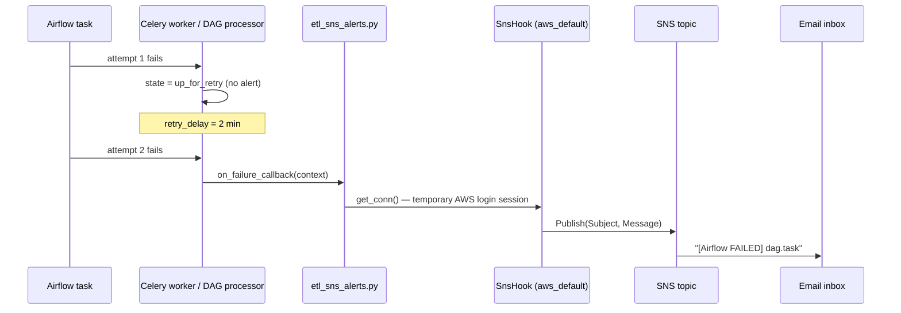

# Monitoring and Alerting (Amazon SNS)

When an Airflow task in either ETL DAG fails **for the last time** (after its
retry), Airflow calls `send_sns_failure_alert`. The callback publishes one
message to the SNS topic `retail-etl-airflow-alerts` (eu-west-2), and SNS
delivers it to every confirmed email subscription.



## Components

| Piece | Location | Role |
|---|---|---|
| Callback | [`airflow/plugins/etl_sns_alerts.py`](../airflow/plugins/etl_sns_alerts.py) | Builds and publishes the alert. Never raises. |
| Wiring | `default_args["on_failure_callback"]` in [`retail_etl_dag.py`](../airflow/dags/retail_etl_dag.py) and [`incremental_s3_orders_dag.py`](../airflow/dags/incremental_s3_orders_dag.py) | Applies to all 11 + 8 tasks |
| AWS connection | `AIRFLOW_CONN_AWS_DEFAULT` in [`docker-compose.yaml`](../docker-compose.yaml) | Key-less `aws` connection with region `eu-west-2` |
| Credentials | `~/.aws/config` + `~/.aws/login/cache` mounted into **worker** and **DAG processor** | Temporary credentials from `aws login`. No static keys |
| Topic ARN | `AWS_SNS_TOPIC_ARN` in `.env` | Not committed |
| Manual test | [`python_scripts/send_test_sns_alert.py`](../python_scripts/send_test_sns_alert.py) | Sends one alert through the same function |
| Health check | `connection_healthcheck` DAG | Read-only check that the topic is reachable |

### Why both the worker and the DAG processor need AWS access

In Airflow 3, a task's `on_failure_callback` runs in the task runner **on the
worker** for normal failures. When a task dies without reporting back (killed
process, heartbeat timeout, out of memory), the scheduler sends the callback
to the **DAG processor**. Both containers mount the AWS login session so that
alerts work in both cases.

## Alert behaviour

| Situation | Email? |
|---|---|
| Task fails, retry pending (`up_for_retry`) | **No** |
| Task fails on its final attempt (`failed`) | **Yes, exactly one** |
| Downstream tasks skipped as `upstream_failed` | No (only the task that actually failed alerts) |
| `SQLCheckOperator` gate returns FALSE | Yes, because a failed data-quality check is a task failure |
| SNS publish itself fails | No email. The error is logged in the task log as `SNS failure alert could not be published` |

Example message:

```text
Subject: [Airflow FAILED] retail_etl_pipeline.validate_staging

Snowflake ETL Pipeline - Task Failure Alert
===========================================

An Airflow task failed after exhausting its retries.

DAG:          retail_etl_pipeline
Task:         validate_staging
Run ID:       manual__2026-11-16T10:00:00+00:00
Logical date: n/a (manual run)
Attempt:      2 (retries allowed: 1)
Error type:   AirflowException

Full error details are in the Airflow task log:
http://localhost:8080/dags/retail_etl_pipeline/runs/.../tasks/validate_staging
```

**Security choices:**

* Only the exception **class** is emailed. Exception messages can contain SQL,
  file paths or connection details, so those stay in the access-controlled
  Airflow log.
* The topic ARN is validated before use.
* The subject is made ASCII-only and kept under 100 characters, as SNS
  requires.

## Setup (one-time)

1. **Create the topic and subscription** (already done for this project):
   ```powershell
   aws sns create-topic --name retail-etl-airflow-alerts --region eu-west-2
   aws sns subscribe --region eu-west-2 --protocol email `
       --topic-arn <topic-arn> --notification-endpoint <your-email>
   ```
   Confirm the subscription from the email that AWS sends.
2. **IAM permissions** for the identity used by `aws login`, as least privilege:
   ```json
   {
     "Version": "2012-10-17",
     "Statement": [
       {"Effect": "Allow", "Action": "sns:Publish", "Resource": "<topic-arn>"},
       {"Effect": "Allow", "Action": "sns:GetTopicAttributes", "Resource": "<topic-arn>"}
     ]
   }
   ```
   `sns:GetTopicAttributes` is only needed by the health-check DAG.
3. **Configure** `.env`: `AWS_SNS_TOPIC_ARN=<topic-arn>`.
4. **Log in and restart:**
   ```powershell
   aws login                 # refresh the temporary session
   docker compose up -d      # containers read the mounted session
   ```

## Testing without touching data

Run these in order. None of them modifies Snowflake, S3 or Airflow metadata.

```powershell
# 1. Unit tests: callback logic with a fake SNS client
python -m pytest tests/test_sns_alerts.py -v

# 2. DAG wiring: every task has the callback and retries = 1 (Airflow image)
make test-dags

# 3. Connections: STS, S3 objects, SNS topic and Snowflake (read-only DAG)
docker compose exec airflow-api-server airflow dags trigger connection_healthcheck

# 4. Real email through the production callback, from the worker container
docker compose exec airflow-worker python /opt/airflow/python_scripts/send_test_sns_alert.py
```

Step 4 prints `Test alert accepted by SNS. MessageId=...`, and an email with
the subject `[Airflow FAILED] manual_alert_test.send_test_sns_alert` should
arrive within about a minute.

> **History:** the end-to-end path (a deliberately failing task, the Airflow
> callback, SNS, then email) was first verified with a temporary DAG that ran
> `exit 1`. That DAG has been removed so it cannot fire by accident.
> `send_test_sns_alert.py` replaces it, and `tests/test_dag_integrity.py`
> asserts it stays removed.

## Troubleshooting

| Symptom | Likely cause | Fix |
|---|---|---|
| Log: `AWS_SNS_TOPIC_ARN is not set` | `.env` value missing, or containers not recreated | Set it, then `docker compose up -d` (recreates containers) |
| Log: `not a valid SNS topic ARN` | Typo or extra quotes | Copy the ARN from `aws sns list-topics --region eu-west-2` |
| `ExpiredToken`, `UnauthorizedSSOTokenError`, `Your session has expired` | The `aws login` session expired | Run `aws login` on the host. The mounted cache refreshes automatically |
| `NoCredentialsError` | Login cache not mounted. On macOS/Linux, `USERPROFILE` is unset | Set `AWS_CONFIG_DIR=$HOME/.aws` in `.env` |
| `AuthorizationError ... sns:Publish` | IAM policy is missing | Add the policy above |
| Message accepted but no email | Subscription unconfirmed or in spam | `aws sns list-subscriptions-by-topic --topic-arn <arn>`. Status must not be `PendingConfirmation` |
| Alert on a killed task never arrives | DAG processor has no AWS mount | Check the `airflow-dag-processor` volumes in `docker-compose.yaml` |
| Two emails for one failure | Callback also attached at DAG level | Keep it only in `default_args` (task level) |

Useful commands:

```powershell
docker compose logs airflow-worker | Select-String "SNS"
docker compose exec airflow-worker airflow connections get aws_default
docker compose exec airflow-worker python -c "import boto3; print(boto3.client('sts').get_caller_identity()['Arn'])"
```
